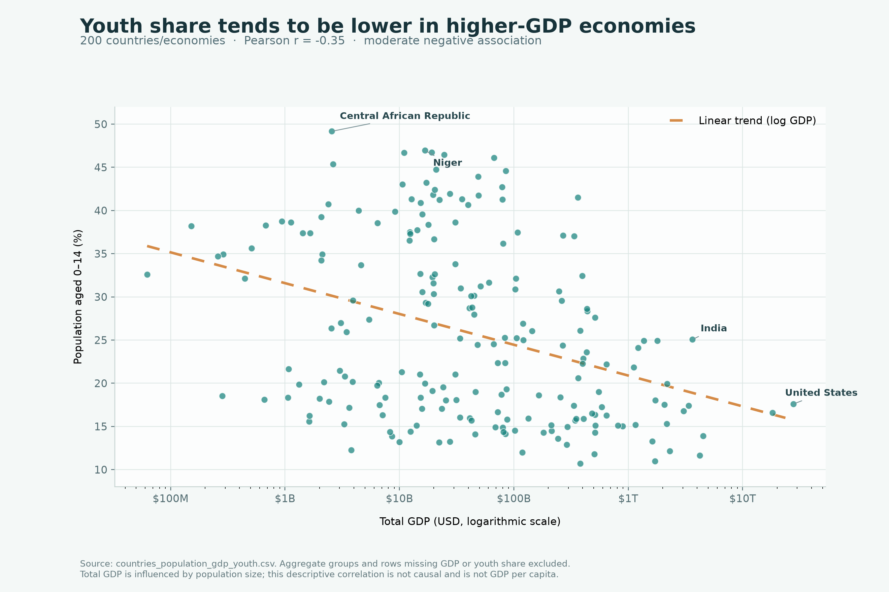

# GDP and Youth Population Visualization

An exploratory data-visualization project examining the relationship between
the share of young people and total GDP across countries and economies. It also
demonstrates clearer redesigns of three supplied visualizations.

> **Main takeaway:** In the observations plotted, youth share has a moderate
> negative association with the logarithm of total GDP (Pearson *r* = −0.354).
> This is a descriptive result, not evidence of causation.

## GDP and youth share

The scatter plot uses a logarithmic horizontal axis because GDP varies widely
between economies. Each point represents one country or economy, and the
dashed line shows the linear trend against log-transformed GDP.



**Interpret with care:** Total GDP is affected by population size and is not
GDP per capita. The chart does not compare average income or establish that
GDP causes changes in youth share. The supplied CSV does not specify a data
year in its columns.

## Data checks

The analysis script reads `countries_population_gdp_youth.csv` and checks the
expected columns, duplicate names, numeric values, and valid ranges. In the
provided file:

- **266** rows are present.
- **18** rows have no GDP, **1** has no youth percentage, and **1** has no
  population value.
- **49** regional, income, development-group, or other aggregate/classification
  entries are excluded from the country/economy comparison.
- **200** observations remain after excluding aggregates and rows missing GDP
  or youth percentage.

Population is validated and its missing values are reported, but it is not
used to size or filter the scatter-plot points.

## Corrected visualization examples

The repository includes redesigns of three visuals from the assignment:

| File | Redesign |
| --- | --- |
| `Corrected_Election_Graphic.png` | A common zero baseline for the 46% and 47% values shown in the supplied image. |
| `Corrected_Cost_Trend_Mockup.png` | A multi-series line-chart layout for comparing categories over time. |
| `Corrected_Ancestry_Mockup.png` | A sorted horizontal bar-chart layout for comparing normalized prevalence. |

The election values are transcribed from the supplied image; polling source,
date, sample size, and margin of error were not provided. The cost and ancestry
charts are **illustrative mockups with invented values**, not findings from
the original charts. Their underlying source data was not supplied.

## Run the analysis

Requires Python 3.10 or later.

### Windows (PowerShell)

```powershell
python -m venv .venv
.\.venv\Scripts\Activate.ps1
python -m pip install -r requirements.txt
python analysis.py
```

### macOS or Linux

```bash
python3 -m venv .venv
source .venv/bin/activate
python -m pip install -r requirements.txt
python analysis.py
```

The script saves `Correlation_GDP_Youth.png` beside `analysis.py`. The
repository includes the generated chart so it can also be viewed without
running the script.

## Project files

| File | Description |
| --- | --- |
| `analysis.py` | Validates the input data, calculates the correlation, and generates the scatter plot. |
| `countries_population_gdp_youth.csv` | Supplied country/economy data. |
| `Correlation_GDP_Youth.png` | Generated GDP and youth-share scatter plot. |
| `Corrected_Election_Graphic.png` | Election graphic redesign. |
| `Corrected_Cost_Trend_Mockup.png` | Illustrative cost-chart redesign. |
| `Corrected_Ancestry_Mockup.png` | Illustrative ancestry-chart redesign. |
| `requirements.txt` | Python dependency list. |

## Limitations

This is an exploratory comparison of total GDP and youth share. Aggregate
groups are excluded to avoid mixing regional totals with individual
countries/economies. Missing data are not imputed. Correlation does not imply
causation, and a different measure such as GDP per capita would address a
different question.
