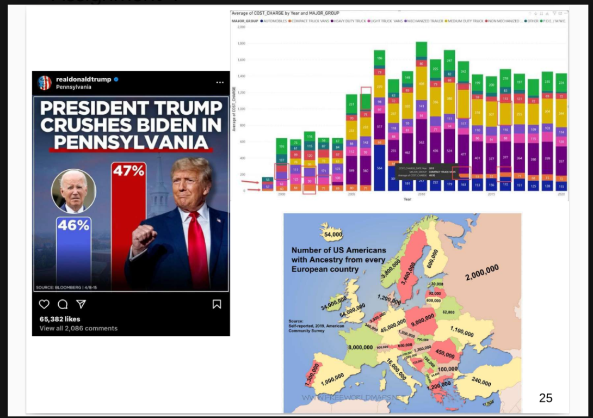
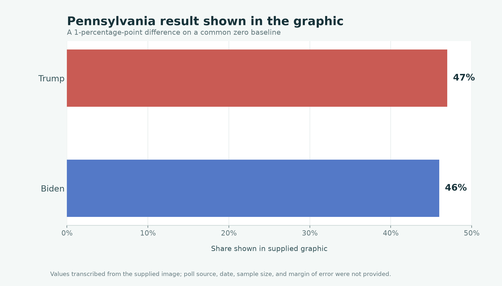
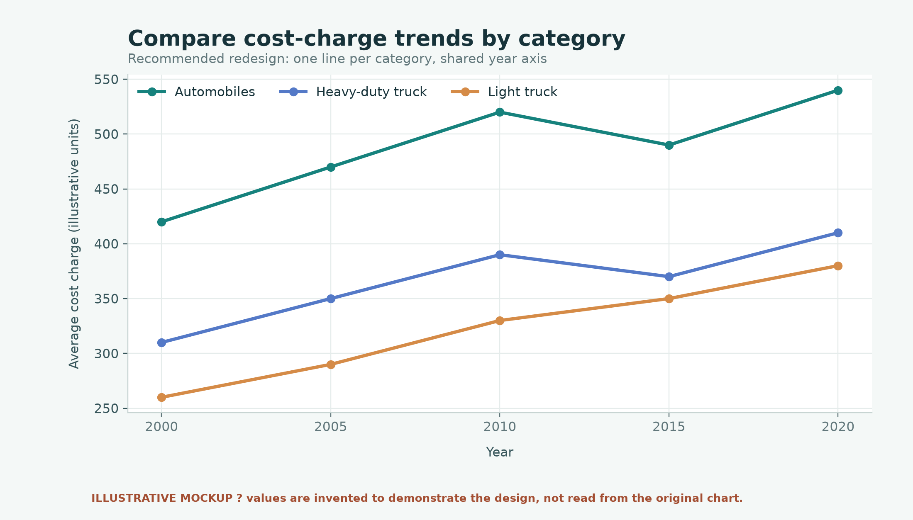
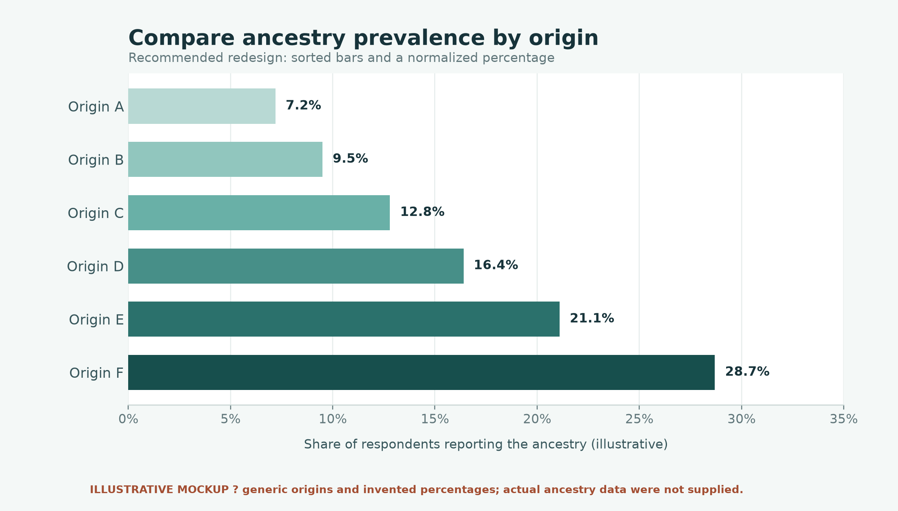

# GDP and Youth Population Visualization

An exploratory data-visualization project examining the relationship between
the share of young people and total GDP across countries and economies. It also
demonstrates clearer redesigns of three supplied visualizations.

> **Main takeaway:** In the observations plotted, youth share has a moderate
> negative association with the logarithm of total GDP (Pearson *r* = −0.354).
> This is a descriptive result, not evidence of causation.

## GDP and youth share

The scatter plot uses a logarithmic horizontal axis because GDP varies widely
between economies. Each point represents one country or economy, and the
dashed line shows the linear trend against log-transformed GDP.


**Interpret with care:** Total GDP is affected by population size and is not
GDP per capita. The chart does not compare average income or establish that
GDP causes changes in youth share. The supplied CSV does not specify a data
year in its columns.

## Data checks

The analysis script reads `countries_population_gdp_youth.csv` and checks the
expected columns, duplicate names, numeric values, and valid ranges. In the
provided file:

- **266** rows are present.
- **18** rows have no GDP, **1** has no youth percentage, and **1** has no
  population value.
- **49** regional, income, development-group, or other aggregate/classification
  entries are excluded from the country/economy comparison.
- **200** observations remain after excluding aggregates and rows missing GDP
  or youth percentage.

Population is validated and its missing values are reported, but it is not
used to size or filter the scatter-plot points.

## Original visuals and corrected designs

The image below preserves the three original visuals as supplied in the
assignment. The issues and redesigns are described below it.



### 1. Election graphic: Trump 47% vs. Biden 46%

**What is wrong:** The bars do not communicate a clear common zero baseline,
so the one-percentage-point difference can appear much larger than it is.
The headline also presents a narrow lead as decisive without showing polling
uncertainty or context.

**How to correct it:** Use equal scales and a clearly marked 0% baseline, or
use a dot plot that presents the small difference without exaggeration. Add
the poll source, date, sample size, and margin of error; avoid claims stronger
than the poll supports.

**Corrected example:**



The 46% and 47% values are transcribed from the supplied image. Poll metadata
were not provided.

### 2. Stacked bar chart: average cost charge by year

**What is wrong:** The many categories, colors, and labels make the chart hard
to read. Stacking averages suggests the segments add to a meaningful total,
and makes it difficult to compare most categories between years.

**How to correct it:** Use a line chart with one line per category, or small
multiples when there are too many categories. Focus on the most relevant
categories, simplify the palette, remove unnecessary labels, and state the
cost units clearly.

**Corrected layout example:**



This is an **illustrative mockup with invented values**, not a result from the
original chart; its source data was not supplied.

### 3. European ancestry map

**What is wrong:** Overlapping labels and unrelated colors make values hard to
compare. Absolute counts can also mislead when comparing prevalence across
populations of different sizes; ancestry responses may overlap.

**How to correct it:** A sorted bar chart is easier to compare. Define the
measure, use percentages when comparing prevalence, explain how multiple
ancestry responses are handled, and move detailed values to a separate table
or interactive labels.

**Corrected layout example:**



This is an **illustrative mockup with invented values and generic labels**,
not a result from the original map; its source data was not supplied.

## Run the analysis

Requires Python 3.10 or later.

### Windows (PowerShell)

```powershell
python -m venv .venv
.\.venv\Scripts\Activate.ps1
python -m pip install -r requirements.txt
python analysis.py
```

### macOS or Linux

```bash
python3 -m venv .venv
source .venv/bin/activate
python -m pip install -r requirements.txt
python analysis.py
```

The script saves `Correlation_GDP_Youth.png` beside `analysis.py`. The
repository includes the generated chart so it can also be viewed without
running the script.

## Project files

| File | Description |
| --- | --- |
| `analysis.py` | Validates the input data, calculates the correlation, and generates the scatter plot. |
| `countries_population_gdp_youth.csv` | Supplied country/economy data. |
| `Correlation_GDP_Youth.png` | Generated GDP and youth-share scatter plot. |
| `Original_Visuals.png` | Supplied image showing the three original visuals being critiqued. |
| `Corrected_Election_Graphic.png` | Election graphic redesign. |
| `Corrected_Cost_Trend_Mockup.png` | Illustrative cost-chart redesign. |
| `Corrected_Ancestry_Mockup.png` | Illustrative ancestry-chart redesign. |
| `requirements.txt` | Python dependency list. |

## Limitations

This is an exploratory comparison of total GDP and youth share. Aggregate
groups are excluded to avoid mixing regional totals with individual
countries/economies. Missing data are not imputed. Correlation does not imply
causation, and a different measure such as GDP per capita would address a
different question.
